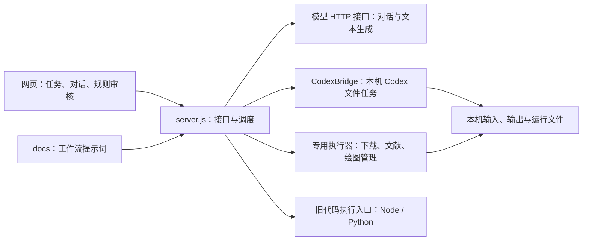

# 工程架构速查

核对日期：2026-10-29；源码基线：`3d40f1e`（已同步origin/main）+ 本轮清洗改造。记录已实现能力，供维护时先查入口；规划见各工作流草稿。运行中的版本、模型和任务状态需查询接口，不能由本文推断。

## 1. 总体结构

本机研究工作台：原生 HTML/CSS/JavaScript + Node.js 内置 HTTP 服务 + 按需使用的 Python/Codex。没有前端构建步骤，也没有统一的服务端研究数据库。



- 数据准备关系：下载、清洗、文献挖掘可并列开展，按需交给计算，再到绘图、结果核查、人工审核；交接文件需明确操作。
- 九步研究流程是另一套任务组织与审核展示，复用这些能力；“模块已展示”不等于所有业务已自动化。
- **工作流文档是提示词资产；程序执行器是代码资产；Codex skill是另一层可加载指令。三者不等同。**直接在桌面Codex对话不自动经过本Web工作流。

## 2. 职责与代码入口

| 职责 | 主入口 | 负责什么 |
| --- | --- | --- |
| 页面与状态 | [index.html](../index.html)、[js/store.js](../js/store.js)、[js/app.js](../js/app.js) | 页面装配、状态读写与渲染；`Store`为共享状态接口 |
| 任务与流程 | [js/tasks.js](../js/tasks.js)、[js/tabs.js](../js/tabs.js) | 任务隔离、模块关系、候选规则、人工确认与规则版本 |
| 对话与操作 | [js/chat.js](../js/chat.js)、[js/codex.js](../js/codex.js)、[js/literature.js](../js/literature.js) | 模块对话、文件/模型设置、执行面板、进度与交接 |
| 服务总入口 | [server.js](../server.js) | 静态文件、接口校验、模型代理、`workflowPrompt()`、专用执行器路由；目前仍集中在一个文件 |
| 本机Codex | [tools/codex-bridge.js](../tools/codex-bridge.js)、[tools/codex-runtime.js](../tools/codex-runtime.js) | 发现运行时、登录与模型目录、JSON-RPC任务、文件及执行状态 |
| 启动与版本 | [tools/start-workbench.js](../tools/start-workbench.js)、[tools/workbench-proxy.js](../tools/workbench-proxy.js)、[tools/literature-runtime.js](../tools/literature-runtime.js) | 核对工作区和后台指纹、复用/更新后台、端口别名 |

`server.js`的`WORKFLOW_FILES`决定各模块加载哪个`docs/*workflow*.md`；共享指导在[workflow-drafts.md](workflow-drafts.md)。改对话行为先查这里，改执行行为再查对应执行器。

## 3. 各模块实际执行到哪里

| 模块 | 已有程序能力 | 关键入口与限制 |
| --- | --- | --- |
| 下载数据 | 确认方案→定位/下载→筛选→检查→交给清洗 | [faostat-download.js](../tools/faostat-download.js)、[faostat_filter.py](../tools/faostat_filter.py)、[source-download.js](../tools/source-download.js)；已接FAOSTAT TM及明确公开文件地址，非任意数据库自动获取 |
| 数据清洗 | 固定画像→确认规则/选择表→冻结项目脚本→沙箱执行→独立核验→原脚本重跑/复现包 | [cleaning.js](../tools/cleaning.js)、[cleaning_core.py](../tools/cleaning_core.py)、`js/tasks.js`、`js/codex.js`；CSV/TSV/Excel通用底座，科学处理仍由项目规则及脚本定义；见[清洗说明](cleaning.md) |
| 文献挖掘 | 检索→去重→全文→参数提取→校验→导出 | [literature-connector.js](../tools/literature-connector.js)调度六个`tools/literature_*.py`阶段；配置冻结、阶段续跑、材料及出处检查 |
| 模型调整与计算 | 直接运行已有代码，或按确认方案修改后运行 | `tools/codex-bridge.js`；依赖上传的代码、数据和方案，没有内置通用科研模型；参数/活动数据更新是可选子环节 |
| 绘图 | 冻结审核方案/输入指纹→Codex作图→版本和预览检查 | [plotting.js](../tools/plotting.js) + CodexBridge；图形代码仍由任务生成 |
| 结果核查、人工审核 | Codex只读核查材料；人决定通过/退回 | `js/tasks.js`、CodexBridge及对应工作流；模型建议不能替代人工审核 |
| 九步流程辅助 | 文献调研、候选问题、写作等辅助入口 | [literature-research.js](../tools/literature-research.js)、[research-question.js](../tools/research-question.js)、`js/chat.js`；各环节能力不同，不能视为全自动投稿流水线 |

文献另有兼容旧批次的[tools/literature-flow.js](../tools/literature-flow.js)；新六阶段任务走`literature-connector.js`，改动时需区分。SOC专用项目在[SOC-database-pipeline-clean/](../SOC-database-pipeline-clean/)，独立保留，未与通用文献输出自动合并。

## 4. 模型与执行路径

- **普通API对话**：`/api/ai/chat`→服务端模型HTTP请求；支持页面配置或`.env`，部分路径有重试/模型降级，需核对实际使用记录。对话本身没有文件执行工具。`/api/ai/compose`生成文档/代码/诊断文本，可选API或`CodexBridge.compose()`；旧“生成代码后运行”另走`/api/code/exec`。
- **本机Codex**：`/api/codex/run`→`CodexBridge.run()`→本机`codex app-server`（stdio JSON-RPC）。优先发现新版桌面包`codex-cli/bin/codex`。每次建立临时会话；按模块选模型，未选时优先目录中的`gpt-6-sol`，不在目录则展示账号默认；推理明确设置`high`。`WORKBENCH_CODEX_MODEL`/`WORKBENCH_CODEX_EFFORT`可覆盖项目默认；冻结清洗重跑保留原推理记录，不隐式替换旧任务配置。
- 模型目录来自`model/list`，可能缓存；列表可见不等于推理成功。桌面选中的模型、对话、插件与skill不自动完整继承；桥接显式关闭MCP和多智能体。实际模型以具体运行记录为准。
- Codex讨论模式为只读；获准执行时仅开放本次输出目录写入，工具网络关闭。专用下载/文献执行器有自己的网络与浏览器路径；不要把两者能力混为一谈。

## 5. 数据、配置与迁移

| 保存位置 | 内容与注意事项 |
| --- | --- |
| 浏览器`localStorage` | 对话、任务、确认规则、页面/模型设置及页面配置的API密钥；入口为`js/store.js`、`js/tasks.js`、`js/api-keys.js`。按浏览器与网址隔离，换端口也可能看到不同记录 |
| `.workbench/<session>/input/`、`output/<job>/` | 上传原件副本、各次Codex/下载运行成果；绘图另有`.plots/`记录，清洗另有`.cleaning/<id>/`状态/冻结包。清洗重启后标记中断，已冻结脚本可另建运行重跑 |
| `.workbench/literature/<job>/` | 冻结`run_config.json`、任务记录、候选、材料、提取、校验与导出；由文献连接器负责恢复/续跑 |
| `.workbench/source-cache/` | 原始下载包缓存；下载运行的`run-state.json`另随运行目录保存 |
| `.env`、`.venv/`、`requirements*.txt` | `.env`是配置，`.venv`是Python环境；文献、绘图、清洗Excel有各自准备清单，其他依赖不保证自动齐备；`CODEX_BIN`/`WORKBENCH_PYTHON`可指定运行时 |
| `examples/`、`outputs/`、SOC子目录 | 案例、人工保存的交付文档和独立子项目；不是当前Web任务状态的统一来源 |

浏览器备份不含API密钥、Codex登录或服务端任务文件，跨电脑需分别迁移。旧`/api/code/exec`产物位于`YANXU_RUN_DIR`或用户`yanxu-runs`，失败时可回退临时目录。网页登录是本地演示门禁，服务默认只监听`127.0.0.1`。

## 6. 快速定位与维护

| 常见问题 | 先查哪里 |
| --- | --- |
| 模块会做什么，提示词是否生效？ | 本文§3→`server.js: workflowPrompt()`→对应工作流文档 |
| 清洗为何还没执行、确认了哪版？ | `js/tasks.js: extractRules/confirmRules/executeRules`→`js/codex.js: prepareConfirmedExecution` |
| Web实际能选哪个模型？ | `GET /api/codex/status`；任务实际选择查`GET /api/codex/job`；实现为`CodexBridge.status/run` |
| 新页面为何连到旧后台？ | `GET /api/literature/runtime`的`loadedFingerprint/restartRequired`，再查启动器；8123/18125可由同一后台与别名转发提供 |
| 文件在哪、刷新/换电脑为何不见？ | 本文§5→区分浏览器记录、session文件、文献job及旧执行目录 |
| 文献卡在哪一阶段？ | `/api/literature/job`、`job.json`及阶段材料状态；新流水线与旧批次分别排查 |

```bash
# 从项目根目录启动；Node.js 18+，默认访问 localhost:8123，无需 npm install。
npm start
# 检查当前运行服务的状态与近期错误，不启动模型推理。
node tools/debug-report.js
# 仅做 package.json 中列出的基础 JavaScript 语法检查，不代表完整测试。
npm run check
```

维护约定：职责、执行能力、接口、存储布局或默认行为改变时，**同一改动更新本文相应行和核对日期/源码基线**；细节与测试留在专项文档，不在这里复制长清单。维护先查本文，再定点核实源码；在线状态、权限、最新模型及新故障仍需实测。

专项入口：[使用指南](user-guide.md) · [接口契约（含历史章节）](contract.md) · [Codex接入](codex-web-integration.md) · [文献六阶段设计](literature-mining-stage2-design.md) · [调试说明](debug-tool.md)。
