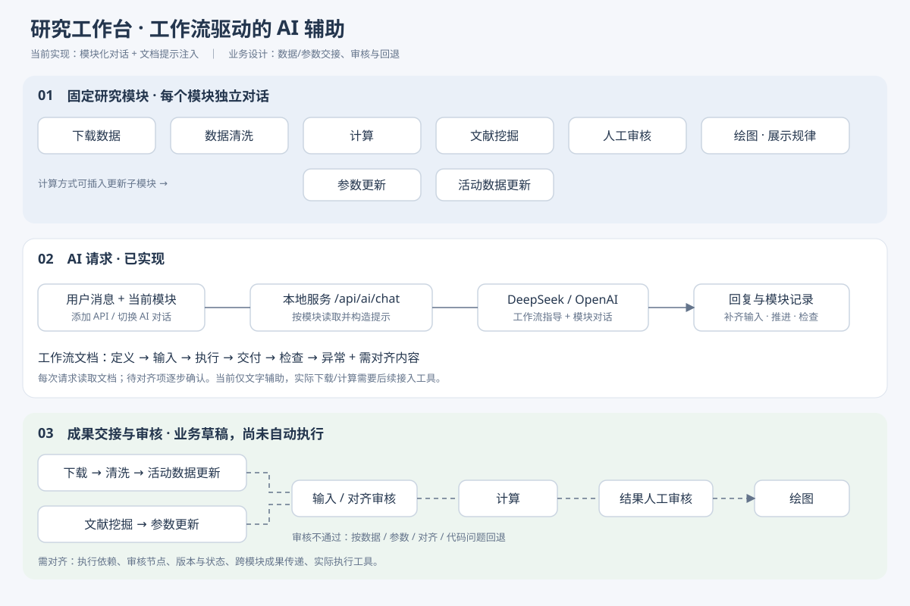
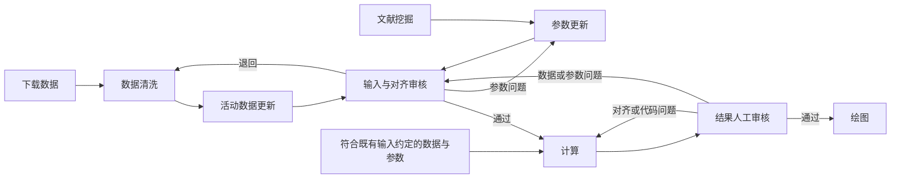
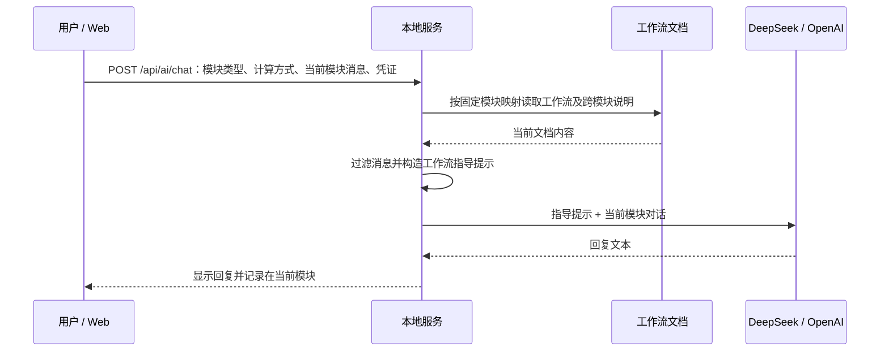

# 研究工作台设计说明

版本：v0.2 · 2026-09-29。本文整理当前实现与工作流草稿；待对齐方案不代表已实现功能。图中 AI 请求层为原 API 对话设计；本机 Codex 接入见下文与[接入说明](codex-web-integration.md)。

## 1. 总体设计

工作台提供固定研究模块，每个模块有独立对话记录。用户配置 DeepSeek 或 OpenAI 后，在模块内通过 AI 对话推进工作。服务端根据模块类型读取工作流文档，将其作为提示传给 LLM；工作流文档是业务指导的统一来源。

总体设计分为三层：模块化研究空间、按工作流指导的 AI 对话、研究成果的审核与交接。当前前两层已有实现；成果文件管理、自动执行、跨模块交接和审核回流仍是设计草稿。

## 2. 模块及业务关系

| 模块 | 主要职责 | 预期交付 |
|---|---|---|
| 下载数据 | 根据确认来源和范围获取原始数据 | 原始包、来源清单、下载摘要 |
| 数据清洗 | 将自然语言清洗要求转成规则并处理数据 | 清洗数据、规则、质量报告与变更记录 |
| 计算 | 直接计算，或对齐更新输入后用既定方法计算 | 结果、方法/输入版本、运行与检查报告 |
| 参数更新 | 将候选参数对齐为新的计算参数版本 | 参数表、来源证据、新旧差异 |
| 活动数据更新 | 将新活动数据对齐并合并到计算输入 | 活动数据版本、映射与更新差异 |
| 文献挖掘 | 根据主题检索和提取文献 meta 与研究参数 | 文献表、参数明细、证据与待审清单 |
| 人工审核 | 按验收标准审阅成果并决定通过或退回 | 审核结论、问题清单、修正要求 |
| 绘图 | 根据研究问题展示趋势、分布、差异等规律 | 图、绘图数据/代码、图注与说明 |

当前界面按“下载数据 → 数据清洗 → 计算 → 文献挖掘 → 人工审核 → 绘图”追加模块。计算可选直接计算，或在其后插入参数更新/活动数据更新子模块。

业务依赖与界面排列需要进一步对齐：活动数据通常经下载、清洗、更新后进入计算；文献参数通常经文献挖掘、参数更新后进入计算；人工审核可发生于规则确认、输入发布和结果验收等多个节点。下面的关系是拟定业务设计，尚未实现自动调度。

两类审核均由“人工审核”能力承接。直接计算可以使用已有合格输入；是否需要额外审核、哪些状态允许进入计算仍需确认。图中回退表示业务责任关系，不表示当前页面已具备回流按钮或状态机。

## 3. 每个模块的工作流契约

所有模块采用统一结构：

1. **定义**：目标、职责与适用范围。
2. **输入**：必需信息、可选条件与尚需确认的规则。
3. **执行**：能够逐步推进的工作步骤。
4. **交付**：成果、证据、日志和下游需要的说明。
5. **检查**：完整性、一致性、可追溯性与验收要求。
6. **异常**：失败、缺失、冲突和回退的处理方法。
7. **需对齐内容**：未确定的业务选项，逐步讨论后再形成执行规则。

各模块定义见[工作流索引](workflow-drafts.md)。SOC 是文献挖掘的主题实例，其地域、字段和纳排标准由主题配置决定，不能自动套用到其他研究主题。

## 4. AI 对话如何接入工作流

前端 `js/chat.js` 提交模块类型和计算方式。`server.js` 通过固定映射选取文档，每次请求读取最新内容，避免文档与另一份硬编码业务提示各自演变。DeepSeek 的 Chat Completions 请求用 system 消息传入指导；OpenAI 的 Responses 请求用 instructions 传入指导。该说明描述当前仓库的请求实现。

共同提示要求 LLM：结合已有对话判断当前进度；只询问推进所需的关键缺失信息；通常每轮不超过三个问题；逐步生成方案、规则、代码或报告；区分事实、假设、建议、待确认项和已验证结果；人工审核的最终决定由用户给出。待对齐问题用于引导讨论，不当作已批准规则，也不要求用户一次性全部回答。

当前请求携带当前模块最近最多 30 条消息，每条最多 4000 字符；系统展示消息不作为用户可控的模型 system 指令转发。当前没有自动附加其他模块聊天、文件或成果的能力，因此跨模块材料需要用户提供。长对话的早期决定可能超出请求窗口，后续需要设计结构化进度与已确认规则的保存方式。

## 5. 当前实现与能力边界

| 能力 | 状态 |
|---|---|
| 固定模块、可选计算子模块、独立聊天与本地记录 | 已实现 |
| 添加 DeepSeek/OpenAI API Key、选择供应商、本地代理对话 | 已实现 |
| 每个模块按文档注入工作流指导、保留待对齐事项 | 已实现 |
| 文献挖掘工作流说明卡与 SOC 示例 | 已实现 |
| 数据清洗模块上传文件、读取分析、执行已确认步骤与下载成果 | 已通过本机 Codex 接入；使用账号登录，无需 API Key |
| 其他模块自动下载、执行计算和生成附件 | 尚未接入；API 模式提供指导和代码 |
| 成果版本库、跨模块自动传递、运行状态与审核回流 | 待设计与实现 |

API Key 当前保存在浏览器 localStorage，并随请求发送到同源本地代理，由代理调用供应商；也支持服务端环境配置。对话和项目记录主要保存在当前浏览器，尚无共享的成果存储或多用户协作系统。

API 模式的文字回答不会直接执行任务。数据清洗模块新增“本机 Codex”：用户上传文件，在查看模式读取并拟方案，选择执行模式后处理已确认步骤，Web 轮询执行事件并展示结果文件。上传副本与每次输出分开保存于 `.workbench/`。任务默认模型从账号可用模型列表取得；任务写入使用 Codex 沙箱，读取范围目前主要由任务提示限定，详见接入说明。其他模块暂沿用 API 对话。

## 6. 建议后续对齐顺序

1. 明确首期研究场景、活动数据对象、来源及计算方法。
2. 逐模块确认输入字段、规则、交付结构和验收标准。
3. 确认真实执行依赖、两类更新能否同时接入计算、审核位置与回退路径。
4. 定义成果版本、模块间交接、已确认规则与对话进度的持久化方式。
5. 选择首个实际执行工具并接入，验证“输入 → 执行 → 交付 → 检查 → 审核”的完整流程。

这些步骤是下一阶段建议。各模块未决问题继续保留在对应工作流文档中，便于逐项讨论。
